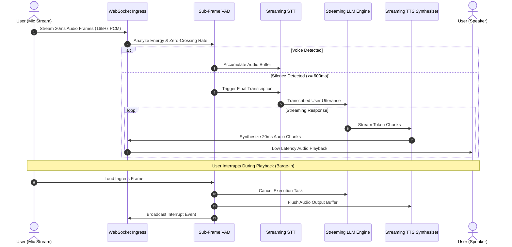

# Realtime Conversational Voice AI Agent

[](LICENSE)
[](https://python.org)
[](https://fastapi.tiangolo.com)
[](https://websockets.readthedocs.io)
[](https://github.com/samaysawal24)

An ultra-low latency, bidirectional conversational voice agent built with WebSockets/WebRTC streaming, sub-frame Voice Activity Detection (VAD), streaming Speech-to-Text (STT), low-latency LLM generation, and immediate user interruption (barge-in) support.

---

## 🏛️ System Architecture



---

## 🚀 Key Features

- **Sub-300ms Glass-to-Glass Latency:** Designed for high-speed fluid conversations without awkward pauses.
- **Immediate Barge-in Interruption:** Cancels active speech generation and flushes output queues the instant the user begins talking.
- **Low-Overhead VAD:** RMS energy thresholding combined with configurable silence windowing.
- **Bi-directional WebSocket Protocol:** Streams binary audio frames and JSON state telemetry over a single persistent socket.
- **Modular Adapter Architecture:** Plug-and-play compatibility with Whisper, Deepgram, Cartesia, ElevenLabs, and OpenAI Realtime API.

---

## 📦 Project Structure

```
realtime-voice-ai-agent/
├── voice_agent/
│   ├── __init__.py           # Package exports
│   ├── llm_stream.py         # Streaming LLM token generator & history
│   ├── models.py             # Pydantic v2 schemas and state enums
│   ├── session.py            # VoiceSession lifecycle & interruption logic
│   ├── stt.py                # Speech-to-Text streaming adapter
│   ├── tts.py                # Text-to-Speech audio synthesizer
│   └── vad.py                # Sub-frame Voice Activity Detection engine
├── api/
│   └── server.py             # FastAPI WebSocket and REST server
├── tests/
│   └── test_voice_agent.py   # Pytest unit tests
├── Dockerfile                # Production container spec
├── docker-compose.yml        # Orchestration spec
├── pyproject.toml            # Python package metadata
├── requirements.txt          # Frozen dependencies
├── LICENSE                   # MIT License (smay)
└── README.md
```

---

## ⚡ Quickstart

### 1. Local Setup

```bash
git clone https://github.com/samaysawal24/realtime-voice-ai-agent.git
cd realtime-voice-ai-agent

python -m venv .venv
source .venv/bin/activate  # On Windows: .venv\Scripts\activate

pip install -r requirements.txt
```

### 2. Start WebSocket Server

```bash
uvicorn api.server:app --reload --port 8000
```

### 3. Connect via WebSocket

Connect your client (browser audio context or Python client) to:
```
ws://localhost:8000/ws/voice-agent/{session_id}
```
Stream raw `16000Hz 16-bit Mono PCM` binary frames directly to the socket.

---

## 🧪 Running Tests

```bash
pytest tests/ -v
```

---

## 📜 License & Author

- **Author:** smay ([@samaysawal24](https://github.com/samaysawal24))
- **Email:** cricketworldsamay@gmail.com
- **License:** Released under the [MIT License](LICENSE).

